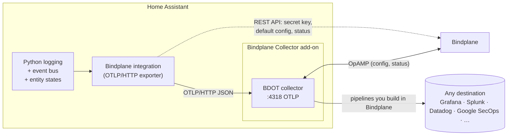

> [!WARNING]
> **Experimental.** This add-on and integration are experimental and may change or break without notice. Bindplane does not provide support for this add-on or integration specifically. Please report problems through [GitHub issues](https://github.com/observIQ/bindplane-home-assistant-add-on/issues).

<div align="center">


# Bindplane for Home Assistant

**Ship Home Assistant logs, metrics and events to any observability backend through a Bindplane-managed OpenTelemetry collector, configured entirely from the HA UI.**

[](https://my.home-assistant.io/redirect/hacs_repository/?owner=observIQ&repository=bindplane-home-assistant-add-on&category=integration)

</div>

---

## What you get

| | |
|---|---|
| 🛰️ **Bindplane Collector add-on** | Runs the [Bindplane Distro for OpenTelemetry Collector](https://github.com/observIQ/bindplane-otel-collector) inside Home Assistant OS, managed remotely by Bindplane over OpAMP. |
| 🔎 **One-click install** | The integration installs, starts and configures the add-on for you. No hostnames, no ports, no YAML. |
| 🔑 **Paste one key, done** | Give the integration a Bindplane API key and it fetches your secret key, creates a `home-assistant` configuration with an OTLP source and the destinations you pick, rolls it out, and attaches the collector. |
| 📜 **Native OTLP logs** | Every Home Assistant log record is sent as an OpenTelemetry log record, with stack traces, source location and severity intact. |
| 📈 **Entity metrics** | Every numeric sensor and on/off entity is sent as an OpenTelemetry gauge once a minute, with its entity ID, name and area. No Prometheus endpoint, no tokens, no scraping. |
| ⚡ **Events as logs (optional)** | Forward HA bus events (`call_service`, `automation_triggered`, `state_changed`, …) as structured log records. |
| 📊 **Health at a glance** | Sensors for exported and dropped records, export status, and, with an API key, the collector's connection status, version and configuration as Bindplane sees them. |

## How it works



1. The **integration** installs and starts the **add-on**, which runs the collector and announces itself to Home Assistant through Supervisor discovery.
2. The integration asks for your Bindplane credentials, writes them into the add-on and restarts it. The collector connects to Bindplane.
3. If you gave it an API key, the integration **applies a default configuration** (OTLP source → your destinations) and labels the collector so Bindplane rolls it out.
4. The integration attaches a handler to Home Assistant's root logger and batches records to the collector over OTLP/HTTP. Everything after that (filtering, parsing, routing, sampling) is done in Bindplane.

## Installation

### 1. Install the integration

With [HACS](https://hacs.xyz): click **Open in HACS** above (or add this repository as a custom repository of type *Integration*), install **Bindplane**, and restart Home Assistant.

Manual: copy `custom_components/bindplane` into your `config/custom_components/` folder and restart.

### 2. Add it

Go to **Settings → Devices & services → Add integration → Bindplane** and pick **Run it here**. The integration adds this repository to the app store, installs the **Bindplane Collector** add-on, starts it and waits for it to come up. You don't need to open the add-on store.

### 3. Connect to Bindplane

| Option | You provide | What happens |
|---|---|---|
| **Bindplane API key** *(recommended)* | API key (+ project ID for scoped `bps_` keys) and the destinations to send to | Secret key fetched for you; `home-assistant` configuration created, rolled out and attached to the collector. |
| **Secret key** | OpAMP endpoint + secret key | Collector connects to Bindplane; you attach a configuration with an OTLP source yourself. |

The integration writes these into the add-on's options and restarts it.

Already installed the add-on yourself? Home Assistant shows **Bindplane Collector discovered** under **Settings → Devices & services**. Click **Configure** and you go straight to step 3.

Not on Home Assistant OS, or already running a collector somewhere else? Pick **Somewhere else** and enter its OTLP/HTTP URL (e.g. `http://192.168.1.20:4318`).

## Options

**Settings → Devices & services → Bindplane → Configure**

| Option | Default | Description |
|---|---|---|
| Minimum log level | `INFO` | Records below this level are not exported. Home Assistant's own [`logger:`](https://www.home-assistant.io/integrations/logger/) level still applies first. |
| Excluded loggers | *(none)* | Logger name prefixes to skip, e.g. `homeassistant.components.recorder`. |
| Forwarded events | *(none)* | Event types to forward as log records. `state_changed` is very chatty. |
| Export metrics | on | Send entity states as gauges every 60 s. |
| Entities excluded from metrics | *(none)* | Entities to leave out of metrics. |

## What a record looks like

```jsonc
{
  "resource": {
    "service.name": "home-assistant",
    "service.version": "2026.10.1",
    "service.instance.id": "6c1f…",       // HA instance UUID
    "host.name": "homeassistant"
  },
  "scope": { "name": "homeassistant.components.zha" },  // logger name
  "severityText": "ERROR",
  "body": "Failed to read attribute",
  "attributes": {
    "code.file.path": "/usr/src/homeassistant/homeassistant/components/zha/…",
    "code.line.number": 142,
    "code.function.name": "async_update",
    "thread.name": "MainThread",
    "exception.type": "TimeoutError",
    "exception.stacktrace": "Traceback (most recent call last): …"
  }
}
```

Forwarded events have `event.name` set to the event type and their data flattened into `event.data.*` attributes.

## Metrics

| Entity | Metric | Value |
|---|---|---|
| Numeric `sensor` | `homeassistant.sensor.<device_class>` (`.value` without one), unit from the entity | the state |
| Anything that is `on`/`off` (`binary_sensor`, `switch`, `light`, `fan`, …) | `homeassistant.<domain>.on` | `1` or `0` |

Each data point has `entity_id`, `friendly_name` and `area` attributes. Non-numeric, `unknown` and `unavailable` states are skipped. Need Prometheus-style names for existing dashboards? Rename them in Bindplane with a processor.

## Entities and actions

| Entity | Description |
|---|---|
| `sensor.bindplane_records_exported` | Log records accepted by the collector |
| `sensor.bindplane_records_dropped` | Records dropped because the buffer was full or the collector rejected them |
| `sensor.bindplane_metric_data_points_exported` | Metric data points accepted by the collector |
| `sensor.bindplane_export_status` | `ok` · `error` · `pending` |
| `sensor.bindplane_collector_status` | Bindplane's view of the collector: `connected`, `disconnected`, … *(API key only)* |
| `sensor.bindplane_collector_configuration` | Configuration currently assigned *(API key only)* |
| `sensor.bindplane_collector_version` | Collector version *(API key only)* |

| Action | Description |
|---|---|
| `bindplane.flush` | Send buffered records now |
| `bindplane.send_test` | Emit a test log record so you can find it in your destination |

## Troubleshooting

- **Export status stays `error`.** The collector has no configuration with an OTLP source yet, so nothing is listening on port 4318. Check in Bindplane that the collector has a configuration containing an **OpenTelemetry (OTLP)** source.
- **Collector doesn't appear in Bindplane.** Check the add-on log. `401` means a bad secret key. Connection errors mean the endpoint is wrong (Bindplane Cloud is `wss://app.bindplane.com/v1/opamp`).
- **Missing debug logs.** Home Assistant's `logger:` level filters records before this integration sees them.
- Download diagnostics from the integration page. Credentials are redacted.

## Development

```bash
python3.13 -m venv .venv && .venv/bin/pip install -r requirements_test.txt
.venv/bin/pytest
```

Layout:

```
bindplane_collector/          Home Assistant add-on (collector + discovery)
custom_components/bindplane/  Home Assistant integration (config flow, OTLP exporter, sensors)
tests/                        pytest-homeassistant-custom-component tests
```
