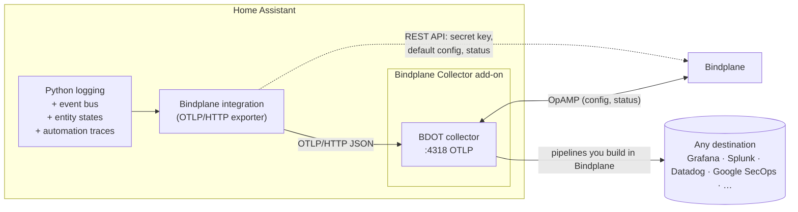

> [!WARNING]
> **Experimental.** This add-on and integration are experimental and may change or break without notice. Bindplane does not provide support for this add-on or integration specifically. Please report problems through [GitHub issues](https://github.com/observIQ/bindplane-home-assistant-add-on/issues).

<div align="center">


# Bindplane for Home Assistant

**Ship Home Assistant logs, metrics, traces and events to any observability backend through a Bindplane-managed OpenTelemetry collector, configured entirely from the HA UI.**

[](https://my.home-assistant.io/redirect/hacs_repository/?owner=observIQ&repository=bindplane-home-assistant-add-on&category=integration)

</div>

---

## What you get

| | |
|---|---|
| 🛰️ **Bindplane Collector add-on** | Runs the [Bindplane Distro for OpenTelemetry Collector](https://github.com/observIQ/bindplane-otel-collector) inside Home Assistant OS, managed remotely by Bindplane over OpAMP. |
| 🔎 **One-click install** | The integration installs, starts and configures the add-on for you. No hostnames, no ports, no YAML. |
| 🔑 **Paste one key, done** | Give the integration a Bindplane API key and it fetches your secret key, creates a `home-assistant` configuration with an OTLP source and the destinations you pick, rolls it out, and attaches the collector. |
| 📜 **Native OTLP logs** | Every Home Assistant log record is sent as an OpenTelemetry log record, with stack traces, source location and severity intact. INFO and up by default, even though Home Assistant itself only logs WARNING. |
| 📈 **Entity and system metrics** | Every entity's state, numeric attributes, availability and change count once a minute, plus CPU, memory, network and disk for Home Assistant, Supervisor and every add-on. No Prometheus endpoint, no tokens, no scraping. |
| 🧾 **Add-on and system logs** | Logs from every running add-on (Z-Wave JS, Mosquitto, ESPHome, …), the Supervisor and the host OS, read through the Supervisor API and tagged with where they came from. |
| 🧭 **Automation traces** | Every automation and script run becomes an OpenTelemetry trace: a root span for the run (with its trigger and result) and nested spans for each trigger, condition and action. Failed runs are marked as errors. |
| ⚡ **Events as logs** | Every HA bus event (`call_service`, `automation_triggered`, …) as a structured log record. `state_changed` is opt-in, since metrics already cover states. |
| 📊 **Health at a glance** | Sensors for exported and dropped records, export status, and, with an API key, the collector's connection status, version and configuration as Bindplane sees them. |

## How it works



1. The **integration** installs and starts the **add-on**, which runs the collector and announces itself to Home Assistant through Supervisor discovery.
2. The integration asks for a Bindplane API key, fetches your secret key with it, writes both into the add-on and restarts it. The collector connects to Bindplane.
3. If you gave it an API key, the integration **applies a default configuration** (OTLP source → your destinations) and labels the collector so Bindplane rolls it out.
4. The integration attaches a handler to Home Assistant's root logger and batches records to the collector over OTLP/HTTP. Everything after that (filtering, parsing, routing, sampling) is done in Bindplane.

## Installation

### 1. Install the integration

With [HACS](https://hacs.xyz): click **Open in HACS** above (or add this repository as a custom repository of type *Integration*), install **Bindplane**, and restart Home Assistant.

Manual: copy `custom_components/bindplane` into your `config/custom_components/` folder and restart.

### 2. Add it

Go to **Settings → Devices & services → Add integration → Bindplane**. The integration adds this repository to the app store, installs the **Bindplane Collector** add-on, starts it and waits for it to come up. You don't need to open the add-on store.

### 3. Connect to Bindplane

Paste a Bindplane API key (plus the project ID for scoped `bps_` keys) and pick the destinations to send to. The integration fetches your secret key, creates and rolls out a `home-assistant` configuration (v2) with an OTLP source, and attaches the collector to it. Pick no destinations and it starts with a `home-assistant-dev-null` destination that discards data until you add a real one.

The integration writes these into the add-on's options and restarts it.

#### API key permissions

Create the key in Bindplane under **Project Settings → API Keys**. A scoped key (`bps_…`) needs:

| Resource | Access | Used for |
|---|---|---|
| Secrets | Read-only | Fetching your secret key |
| Configurations | Read and write | Listing configurations and destinations, creating the `home-assistant` configuration |
| Collectors | Read-only | Collector status sensors |
| Resources | Read and write | Creating the `home-assistant` configuration |
| Rollouts | Read and write | Rolling it out |

Scoped keys also need the **project ID**. The write permissions are only used if you let the integration create the configuration; to use an existing one, read-only is enough. A classic key works if your Bindplane user can edit configurations. If a permission is missing, setup shows the one Bindplane reported and takes you back to the API key step.

Already installed the add-on yourself? Home Assistant shows **Bindplane Collector discovered** under **Settings → Devices & services**. Click **Configure** and you go straight to step 3.

Already running a collector somewhere else? Expand **Advanced: use my own collector** on the first setup screen and enter its OTLP/HTTP URL (e.g. `http://192.168.1.20:4318`). Installs without the Supervisor (Container, Core) can't run add-ons, so they go straight to this step.

## Options

**Settings → Devices & services → Bindplane → Configure**

| Option | Default | Description |
|---|---|---|
| Minimum log level | `INFO` | Records below this level are not exported. Home Assistant normally drops everything below WARNING; the integration lowers that for itself only, so your HA log file stays as it was. Per-integration levels from [`logger:`](https://www.home-assistant.io/integrations/logger/) still apply. |
| Excluded loggers | *(none)* | Logger name prefixes to skip, e.g. `homeassistant.components.recorder`. |
| Forwarded events | All events (except `state_changed`) | Event types to forward as log records. Add `state_changed` explicitly to include it; it's very chatty. |
| Export metrics | on | Send entity states as gauges every 60 s. |
| Entities excluded from metrics | *(none)* | Entities to leave out of metrics. |
| Export automation traces | on | Send automation and script runs as traces. |
| Export add-on and system logs | on | Follow add-on, Supervisor and host logs. Home Assistant OS and Supervised only. |

## What a record looks like

```jsonc
{
  "resource": {
    "service.name": "home-assistant",
    "service.version": "2026.10.1",
    "service.instance.id": "6c1f…",       // HA instance UUID
    "host.name": "homeassistant",
    "host.arch": "arm64",
    "os.type": "linux",
    "os.version": "6.12.…",
    "homeassistant.location_name": "Home",
    "homeassistant.time_zone": "America/Detroit",
    "homeassistant.country": "US",
    "homeassistant.installation_type": "Home Assistant OS"
  },
  "scope": { "name": "homeassistant.components.zha" },  // logger name
  "severityText": "ERROR",
  "body": "Failed to read attribute",
  "attributes": {
    "code.file.path": "/usr/src/homeassistant/homeassistant/components/zha/…",
    "code.line.number": 142,
    "code.function.name": "async_update",
    "thread.id": 140211…,
    "thread.name": "MainThread",
    "exception.type": "TimeoutError",
    "exception.stacktrace": "Traceback (most recent call last): …"
  }
}
```

Attributes follow OpenTelemetry semantic conventions where one exists (`code.*`, `thread.*`, `exception.*`, `container.name`, `user.id`, `error.type`, …), with Home Assistant specifics under `homeassistant.*`. The same names are used on logs, metrics and traces.

Anything about an entity, on any signal, carries:

| Attribute | Notes |
|---|---|
| `homeassistant.entity.id`, `.domain`, `.object_id`, `.name`, `.device_class` | |
| `homeassistant.entity.platform`, `.unique_id`, `.labels` | from the entity registry |
| `homeassistant.device.id`, `.name`, `.manufacturer`, `.model`, `.sw_version` | from the device registry |
| `homeassistant.area.id`, `.name`, `homeassistant.floor.name` | entity's area, or its device's |

Add-on logs and metrics carry `container.name` (`addon_<slug>`) and `homeassistant.addon.slug`, `.name`, `.version`, `.version_latest`, `.update_available`, `.repository`.

Logs and events emitted while an automation or script runs carry that run's `traceId` and root `spanId`, plus `homeassistant.step.path`, so they link to its trace.

Forwarded events set the record's event name to the event type and add:

| Attribute | Notes |
|---|---|
| `homeassistant.event.type`, `homeassistant.event.origin` | |
| `homeassistant.context.id`, `homeassistant.context.parent_id`, `user.id` | |
| `homeassistant.state.old`, `homeassistant.state.new` | `state_changed` only |
| `homeassistant.state.attributes.*` | new state attributes |
| `homeassistant.state.old_attributes.*` | old attribute values that changed |
| `homeassistant.event.data.*` | any other event data |

## Metrics

Sent once a minute, and right after Home Assistant starts.

| Metric | Value | Notes |
|---|---|---|
| `homeassistant.sensor.<device_class>` | numeric sensor state | `.value` without a device class; unit from the entity |
| `homeassistant.<domain>.value` | numeric state of any other entity (`number`, `counter`, `input_number`, …) | |
| `homeassistant.<domain>.on` | `1` / `0` | anything that is `on`/`off` |
| `homeassistant.entity.state` | `1`, with a `homeassistant.state` attribute | text states like `heat`, `home`, `playing`, `open` |
| `homeassistant.<domain>.attribute.<name>` | numeric state attributes | e.g. `climate.attribute.current_temperature`, `light.attribute.brightness`, battery levels |
| `homeassistant.entity.available` | `1` / `0` | `0` when `unavailable` |
| `homeassistant.entity.last_changed` | Unix seconds | |
| `homeassistant.entity.state_changes` | cumulative count | since the integration started |
| `container.cpu.utilization`, `container.memory.*`, `container.network.io`, `container.disk.io` | | Home Assistant, Supervisor and every running add-on, labelled by `container.name` |
| `system.filesystem.usage` | bytes, `system.filesystem.state` = `used`/`free` | host disk |

Entity data points carry the entity attributes above. Need Prometheus-style names for existing dashboards? Rename them in Bindplane with a processor.

## Traces

Each finished automation or script run is one trace. The trace ID is the run ID shown in Home Assistant's trace viewer, so you can jump between the two.

| Span | Attributes |
|---|---|
| `automation: <alias>` / `script: <alias>` (root) | entity attributes, `homeassistant.trace.run_id`, `.domain`, `.item_id`, `.alias`, `.trigger`, `.script_execution` (`finished`, `failed_conditions`, `error`, …), `.last_step`, `homeassistant.context.id`, `.parent_id`, `user.id` |
| `trigger/0`, `condition/0`, `action/1`, `action/1/choose/0/sequence/0`, … | `homeassistant.step.path`, `homeassistant.step.result.*`, `homeassistant.step.variables.*`, `homeassistant.step.child_run_id` |

Steps nest by their path. A step that calls a script links to the script's trace. A failed step or run has an error status and `error.type`.

## Entities and actions

| Entity | Description |
|---|---|
| `sensor.bindplane_records_exported` | Log records accepted by the collector |
| `sensor.bindplane_records_dropped` | Records dropped because the buffer was full or the collector rejected them |
| `sensor.bindplane_metric_data_points_exported` | Metric data points accepted by the collector |
| `sensor.bindplane_trace_spans_exported` | Trace spans accepted by the collector |
| `sensor.bindplane_export_status` | `ok` · `error` · `pending` |
| `sensor.bindplane_collector_status` | Bindplane's view of the collector: `connected`, `disconnected`, … *(API key only)* |
| `sensor.bindplane_collector_configuration` | Configuration currently assigned *(API key only)* |
| `sensor.bindplane_collector_version` | Collector version *(API key only)* |

| Action | Description |
|---|---|
| `bindplane.flush` | Send buffered records now |
| `bindplane.send_test` | Emit a test log record so you can find it in your destination |

## Troubleshooting

- **Export status stays `error`.** The collector has no configuration with an OTLP source yet, so nothing is listening on port 4318. Check in Bindplane that the collector has a configuration containing an **OpenTelemetry (OTLP)** source.
- **Collector doesn't appear in Bindplane.** Check the add-on log. `401` means a bad secret key. Connection errors mean the endpoint is wrong (Bindplane Cloud is `wss://app.bindplane.com/v1/opamp`).
- **Missing debug logs.** Home Assistant's `logger:` level filters records before this integration sees them.
- Download diagnostics from the integration page. Credentials are redacted.

## Development

```bash
python3.14 -m venv .venv && .venv/bin/pip install -r requirements_test.txt
.venv/bin/pytest
```

Layout:

```
bindplane_collector/          Home Assistant add-on (collector + discovery)
custom_components/bindplane/  Home Assistant integration (config flow, OTLP exporter, sensors)
tests/                        pytest-homeassistant-custom-component tests
```

## License

[Apache 2.0](LICENSE)
